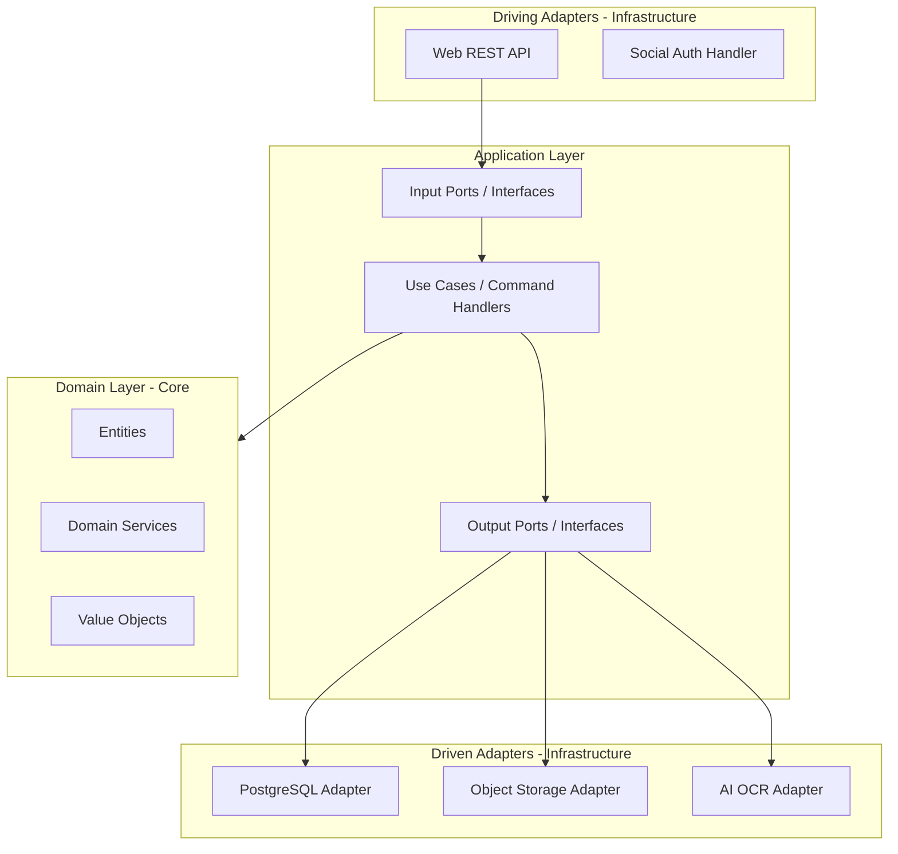
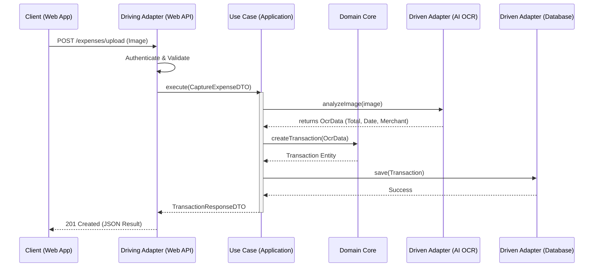

# 🏛️ MemoirFinance Architecture Design

## 1. Kiến trúc Tổng thể (Architectural Overview)

Hệ thống MemoirFinance được xây dựng dựa trên kiến trúc **Hexagonal (Ports & Adapters)** kết hợp với các nguyên lý của **Domain-Driven Design (DDD)**. Sự lựa chọn này nhằm đảm bảo tính cô lập tuyệt đối của logic nghiệp vụ (Business Logic) khỏi các chi tiết kỹ thuật (Framework, Database, AI Services), giúp hệ thống dễ dàng mở rộng và bảo trì trong dài hạn.

### Các Nguyên tắc Thiết kế (Design Principles)
*   **Dependency Rule:** Sự phụ thuộc luôn hướng vào bên trong (Domain Core). Các lớp bên ngoài biết về lớp bên trong, nhưng lớp bên trong không bao giờ biết về lớp bên ngoài.
*   **Persistence Ignorance:** Domain Core không quan tâm dữ liệu được lưu trữ như thế nào (SQL, NoSQL, hay In-memory).
*   **Plug-and-Play Adapters:** Có thể thay thế nhà cung cấp AI OCR hoặc Database mà không phải sửa đổi Logic nghiệp vụ.

---

## 2. Ranh giới các Lớp (Layer Boundaries)

### 2.1. Domain Layer (Lõi Nghiệp vụ)
Đây là trái tim của hệ thống, chứa các quy tắc kinh doanh quan trọng nhất.
*   **Entities:** Các đối tượng có định danh duy nhất (e.g., `User`, `Transaction`, `Wallet`).
*   **Value Objects:** Các đối tượng không có định danh, định nghĩa bởi thuộc tính (e.g., `Money`, `Category`, `ImageMetadata`).
*   **Domain Services:** Chứa logic nghiệp vụ liên quan đến nhiều thực thể (e.g., `OcrAnalysisService`).
*   **Repository Interfaces:** Các định nghĩa trừu tượng về cách truy xuất dữ liệu.

### 2.2. Application Layer (Điều phối)
Lớp này điều phối luồng dữ liệu và thực thi các Use Case.
*   **Use Cases:** Các kịch bản sử dụng thực tế (e.g., `CaptureExpense`, `TransferWallet`, `GenerateMonthlyRecap`).
*   **Input Ports:** Giao diện cho các Driving Adapters gọi vào.
*   **Output Ports:** Giao diện cho các Driven Adapters (e.g., `StoragePort`, `AiOcrPort`, `NotificationPort`).
*   **DTOs (Data Transfer Objects):** Cấu trúc dữ liệu dùng để giao tiếp giữa Adapter và Application.

### 2.3. Infrastructure Layer (Chi tiết Kỹ thuật)
Chứa các implementation thực tế (Adapters).
*   **Primary Adapters (Driving):** Web API (REST/GraphQL), CLI, Cron Jobs.
*   **Secondary Adapters (Driven):** PostgreSQL (Persistence), AWS S3 (Storage), Google Cloud Vision / OpenAI (AI OCR), Firebase (Auth).

---

## 3. Cấu trúc Thư mục (Directory Structure)

```text
src/
├── domain/                      # Domain Layer (Pure Business Logic)
│   ├── entities/                # Thực thể (User, Transaction, Wallet)
│   ├── value_objects/           # Value Objects (Money, Category)
│   ├── services/                # Domain Services
│   └── repositories/            # Interfaces định nghĩa các kho lưu trữ
│
├── application/                 # Application Layer (Orchestration)
│   ├── use_cases/               # Implementation của các kịch bản sử dụng
│   ├── ports/                   # Định nghĩa Input/Output Ports (Interfaces)
│   │   ├── input/
│   │   └── output/
│   └── dtos/                    # Data Transfer Objects
│
├── infrastructure/              # Infrastructure Layer (Adapters & Tools)
│   ├── adapters/                # Ports implementation
│   │   ├── driving/             # Web API, Auth Middlewares
│   │   └── driven/              # DB, Cloud Storage, AI Services
│   ├── persistence/             # Cấu hình Database (ORM models, Migrations)
│   └── external_services/       # Cấu hình các SDK bên thứ ba
│
└── shared/                      # Các thành phần dùng chung (Exceptions, Utils)
```

---

## 4. Sơ đồ Thành phần (Component Diagram)



---

## 5. Luồng Dữ liệu Chi tiết (Detailed Data Flow)

### Kịch bản: Người dùng chụp ảnh hóa đơn (Capture Expense)

1.  **Request:** Người dùng gửi ảnh qua `POST /expenses/upload`.
2.  **Primary Adapter (Web API):** 
    *   Nhận `multipart/form-data`.
    *   Xác thực người dùng qua `AuthHandler` (JWT/OAuth).
    *   Chuyển đổi dữ liệu thô sang `UploadImageRequestDTO`.
3.  **Application Layer (Use Case):**
    *   Gọi `CaptureExpenseUseCase`.
    *   Sử dụng `StoragePort` (Driven Adapter) để lưu ảnh gốc lên S3 và lấy URL.
    *   Sử dụng `AiOcrPort` (Driven Adapter) để gửi ảnh đi phân tích.
4.  **AI OCR Adapter:** 
    *   Gọi Cloud API (e.g., OpenAI gpt-4o-mini / Google Vision).
    *   Parse kết quả JSON thô sang `OcrResult` domain-neutral.
5.  **Domain Layer:**
    *   `Use Case` nhận kết quả OCR, khởi tạo Entity `Transaction`.
    *   Thực hiện kiểm tra nghiệp vụ (e.g., "Giao dịch này có hợp lệ không?", "Gán vào ví mặc định").
    *   `Transaction` entity thực hiện logic đóng gói (encapsulation).
6.  **Secondary Adapter (Persistence):**
    *   `Use Case` gọi `TransactionRepository.save(transaction)`.
    *   `PostgresAdapter` chuyển đổi Domain Entity sang DB Model và thực thi Query.
7.  **Response:** `Use Case` trả về `TransactionResponseDTO`, Web API format lại thành JSON trả về Client.

---

## 6. Sơ đồ Tuần tự (Sequence Diagram)



---

## 7. Ranh giới Nghiệp vụ (Business Boundaries)

*   **Cô lập Framework:** Lớp Domain và Application tuyệt đối không chứa code của Web Framework (FastAPI, Express) hay ORM (SQLAlchemy, Prisma).
*   **Xử lý Lỗi:** 
    *   Infrastructure ném các exception kỹ thuật (e.g., `ConnectionTimeout`).
    *   Application bắt lại và map sang Domain Exception (e.g., `StorageUnavailableException`).
    *   Driving Adapter map Domain Exception sang HTTP Status Code (e.g., 503 Service Unavailable).
*   **Độc lập Kiểm thử:** 
    *   Logic nghiệp vụ có thể được Unit Test 100% mà không cần Mock database (chỉ cần Mock repository interfaces).

---
**Author:** Principal Software Architect
**Version:** 1.0
**Project:** MemoirFinance
